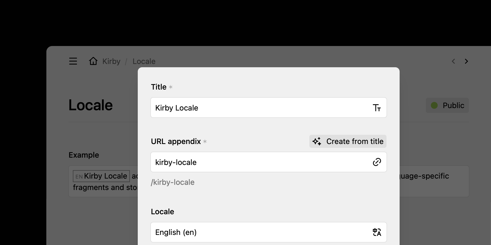

# Kirby Locale

Locale utilities for [Kirby CMS](https://getkirby.com) adds a Writer mark and an optional dialog select field so editors can tag language-specific fragments and store per-page title locales.



## Requirements

- Kirby 5+
- PHP 8.2+

## Installation

```bash
composer require grommasdietz/kirby-locale
```

> [!TIP]
> If you don’t use Composer, you can download this repository and copy it to `site/plugins/kirby-locale`.

## Quickstart

### Writer mark

Enable the locale mark on any Writer field by adding it to the field’s `marks` list:

```yaml
fields:
  text:
    type: writer
    marks:
      - locale
```

The Writer displays the locale mark in the toolbar and highlights tagged segments. Selections get wrapped in `<span lang="…">`.

### Title locales

Activate the title locale selector via `grommasdietz.locale.intendedTemplate` in `site/config/config.php`. For a single template:

```php
return [
    'grommasdietz.locale.intendedTemplate' => 'project',
];
```

See [usage](docs/usage/index.md) for multiple templates, custom locales and API routes.

### Documentation

Full reference for [usage](docs/usage/index.md), [contributions](docs/contributions/index.md) and [maintenance](docs/maintenance/index.md) lives in [documentation](docs/index.md).

---

## Changelog

See [CHANGELOG.md](CHANGELOG.md) for version history and changes.

---

## Security

See [SECURITY.md](SECURITY.md) for security policies and reporting vulnerabilities.

---

## Contributing

See [CONTRIBUTING.md](CONTRIBUTING.md) for guidance and expectations.

---

## License

[MIT](LICENSE.md) © 2025 Grommas Dietz
